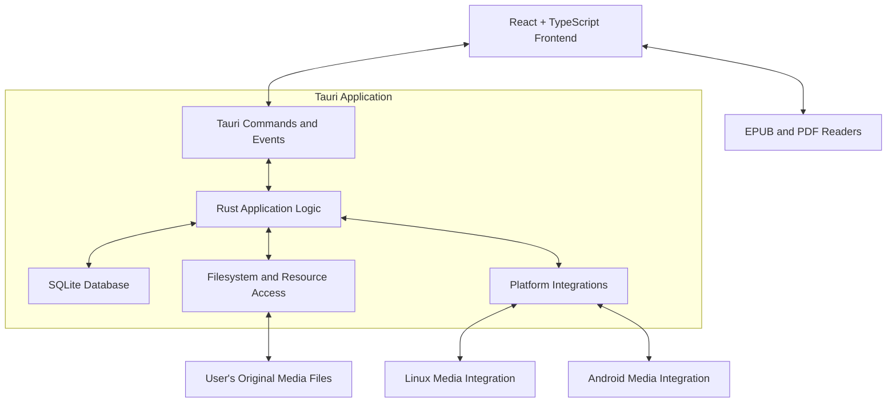

# Colkt Architecture

## 1. Purpose

This document describes the technical architecture of Colkt: a private, offline-first personal media library for Linux desktop and Android.

Colkt organises movies, TV shows, and books in one library. It allows users to manage local media files, track their viewing and reading activity, organise items into user-defined collections called crates, and maintain personal metadata such as ratings, progress, and notes.

The architecture prioritises:

- Offline-first operation.
- Local ownership of library data.
- Privacy and minimal data collection.
- Protection of original media files.
- Consistent behaviour across Linux and Android.
- Clear separation between the user interface, application logic, and platform-specific functionality.
- A maintainable foundation that can grow without unnecessary complexity.

## 2. Technology Stack

### 2.1 Confirmed stack

| Area | Technology |
|---|---|
| Application framework | Tauri 2 |
| Frontend | React |
| Language | TypeScript |
| Frontend tooling | Vite |
| Backend | Rust |
| Local database | SQLite |
| Styling | CSS, CSS Modules, and CSS variables |
| Linux distribution | Flatpak |
| Android distribution | APK |

### 2.2 Platform-specific media technologies

The following technologies are planned, but their integration details must be validated during implementation.

| Platform | Media capability | Planned technology |
|---|---|---|
| Linux | Video playback | GStreamer |
| Android | Video playback | AndroidX Media3 |
| Linux and Android | EPUB reading | Foliate.js |
| Linux and Android | PDF reading | Mozilla PDF.js |

The architecture must allow platform-specific implementations where necessary without forcing the entire application to depend on one platform's media framework.

## 3. High-Level Architecture

Colkt uses a layered architecture.

The React frontend handles presentation and user interaction. The Rust backend owns application logic, database operations, filesystem operations, and platform integration. Tauri provides the communication boundary between the frontend and backend.

SQLite stores Colkt's structured application data. Original media files remain in their existing locations and are accessed through controlled filesystem or platform-specific access mechanisms.

This diagram represents logical responsibilities, not a requirement that every component must be implemented as a separate process or package.

## 4. Frontend Architecture

### 4.1 Responsibilities

The React frontend is responsible for:

- Application screens and navigation.
- Library browsing and searching.
- Movie, TV show, and book details.
- Crate management.
- User profile and application settings.
- Viewing and reading progress interfaces.
- Ratings, notes, and annotations interfaces.
- Playback and reader controls.
- User feedback, loading states, and error presentation.

The frontend should not directly access SQLite or implement privileged filesystem operations.

### 4.2 Frontend and backend boundary

The frontend communicates with the Rust backend through Tauri commands and events.

Commands are used for operations that request work or return data. Events are used for notifications and updates where an event-driven interaction is appropriate.

The communication contract must be documented in `docs/API.md`.

Frontend components should not depend on database implementation details. They should consume application-level data structures returned by the backend.

### 4.3 UI organisation

Frontend code should be organised by application responsibility rather than placing all components in a single directory.

Possible areas include:

- Application shell and navigation.
- Library.
- Movies.
- TV shows.
- Books.
- Crates.
- Readers and playback.
- Profile.
- Settings.
- Shared UI components.

This is a logical organisation guide. Directories should be introduced as their functionality is implemented rather than creating unnecessary empty modules.

### 4.4 UI state and persistent data

The frontend may hold temporary interface state, such as:

- Current screen.
- Selected filters.
- Open dialogs.
- Search input.
- Current selection.
- Temporary form values.

Persistent application data belongs in SQLite and must be accessed through the backend.

The frontend must not become a second source of truth for persistent library data.

## 5. Rust Backend Architecture

### 5.1 Responsibilities

The Rust backend is responsible for:

- Application and domain logic.
- Database access.
- Library item management.
- Local media resource registration.
- Filesystem access and validation.
- Metadata matching and confirmation workflows.
- Progress and rating persistence.
- Crate management.
- Profile and application settings.
- Backup and restore operations.
- Platform-specific integration through appropriate interfaces.

### 5.2 Logical responsibilities

Backend code should maintain clear boundaries between:

**Application commands**

Receive requests from the frontend, validate input, coordinate operations, and return application-level results.

**Domain logic**

Implements the rules governing library entries, media resources, collections, progress, ratings, and other Colkt features.

**Data access**

Reads and writes structured application data in SQLite.

**Platform integration**

Handles operations that differ between Linux and Android, including filesystem access and native media functionality.

These are logical boundaries. They do not require a complex service architecture or a separate process for every responsibility.

### 5.3 Error handling

Backend operations must return structured errors that the frontend can handle.

Errors should distinguish between situations such as:

- Invalid input.
- Missing library entry.
- Missing or inaccessible media file.
- Permission denied.
- Unsupported file format.
- Database failure.
- Platform integration failure.
- Metadata lookup failure.

Sensitive information, including passcodes and unnecessary personal filesystem details, must not be written to application logs.

## 6. Database Architecture

SQLite is the local source of truth for Colkt's structured application data.

It stores information such as:

- Profiles.
- Library entries.
- Media metadata.
- Local media resource references.
- Crates and their membership.
- Ratings.
- Viewing and reading progress.
- Playback and reading state.
- Notes and annotations.
- Application settings.
- Metadata provider identifiers and matching information.

The database schema is defined separately in `docs/DATABASE.md`.

### 6.1 Database ownership

Only the Rust backend should perform persistent database operations.

The frontend must not connect directly to SQLite.

### 6.2 Database integrity

Database operations should preserve referential integrity and use transactions where multiple related changes must succeed or fail together.

Database migrations must be versioned so future application releases can safely update existing user databases.

### 6.3 Database location

Database files must be stored in the platform-appropriate application data directory.

The application must not store its database alongside the user's original media files by default.

### 6.4 Backup and restore

Colkt should support backing up and restoring its application data.

Backups must account for SQLite's journaling mode, including WAL files where applicable. A consistent database snapshot must be used rather than copying only the main database file while it is actively being written.

Original media files are not included in application backups by default. Backups should preserve the references and metadata needed to reconnect those files.

## 7. Media File Architecture

### 7.1 Original file ownership

Colkt does not own the user's original media files.

The application must never automatically:

- Move original files.
- Rename original files.
- Delete original files.
- Modify original file contents.
- Copy entire media libraries into an application-managed directory.

The user remains responsible for the location and organisation of their media files.

### 7.2 Media references

Colkt stores references to local media resources in SQLite.

A library entry and its associated local resource must be treated as separate concepts.

For example:

- A movie may exist in the library without a local video file.
- A book may exist in the library without a downloaded EPUB or PDF.
- A local media file may be discovered without automatically creating a library entry.
- A library entry may have multiple associated local resources where supported.

Removing a resource reference must not automatically delete the corresponding library entry or its viewing and reading history.

### 7.3 Filesystem access

Filesystem access differs between Linux and Android.

**Linux**

The application may access user-selected files and directories subject to operating system permissions and Flatpak sandbox restrictions.

Where required, the application should use appropriate desktop portals to request access.

**Android**

The application should use Android's Storage Access Framework where appropriate.

Android content URIs must be treated as resource identifiers, not ordinary filesystem paths. Persisted URI permissions should be used where the platform allows them.

The backend must not assume that a resource selected on Android can be represented as a normal filesystem path.

### 7.4 Large media files

Large media files must not be transferred through Tauri IPC as complete Base64-encoded strings.

File access should use appropriate native resource access, streaming, or bounded reads depending on the platform and the consuming component.

The implementation must ensure that reader and playback components can access only the resources they are authorised to use.

## 8. Media Identification and Metadata

Colkt supports identifying local media and matching it with library metadata.

Planned metadata providers include:

| Media type | Planned provider |
|---|---|
| Movies | TMDB |
| TV shows | TMDB and/or TVmaze |
| Books | Open Library |

Provider integration is optional and must not make normal library browsing dependent on an internet connection.

### 8.1 Matching workflow

The application may use available information such as:

- Filename.
- Folder structure.
- File metadata.
- Title.
- Release year.
- Author.
- ISBN.
- Other available identifiers.

A match is a suggestion, not an automatic decision.

The user must confirm a proposed match before Colkt links a local resource to an existing library entry or applies identified metadata.

The application must avoid silently merging separate works or resources.

### 8.2 Offline behaviour

When offline:

- Existing library data remains available.
- Previously retrieved metadata remains available.
- Local media access continues where permissions allow.
- Metadata searches and updates requiring network access are unavailable until connectivity returns.

Provider failures must not prevent access to existing library content.

### 8.3 Provider constraints

Metadata integrations must respect provider terms, rate limits, attribution requirements, and applicable licensing conditions.

Provider-specific identifiers should be stored separately from Colkt's own library identifiers.

## 9. Video Playback Architecture

Video playback is a platform-specific capability.

The planned technologies are:

- GStreamer on Linux.
- AndroidX Media3 on Android.

The application should expose a consistent playback experience while allowing the underlying playback implementation to differ by platform.

The playback integration must support, where technically available:

- Opening a selected local video resource.
- Play and pause.
- Seeking.
- Volume control.
- Playback position tracking.
- Resuming from saved progress.
- Handling unavailable or unsupported media.
- Reporting playback state to the application.

The exact hosting and rendering approach for each platform must be validated before implementation. The architecture does not require a particular GTK window arrangement, Android Activity structure, or native plugin design in advance.

Playback progress must be stored through the backend rather than existing only in temporary frontend state.

## 10. EPUB and PDF Reading Architecture

Colkt plans to use:

- Foliate.js for EPUB reading.
- Mozilla PDF.js for PDF reading.

These reader technologies are intended to provide the reading interface inside the application.

### 10.1 Reader responsibilities

The reader layer should handle document presentation and reading interactions.

Colkt's application layer should own persistent user data, including:

- Reading progress.
- Bookmarks.
- Notes.
- Highlights and annotations.
- Reading preferences where applicable.

Reader-specific state should not become the only stored representation of a user's reading history.

### 10.2 Resource access

Readers must receive access to documents through a controlled resource-access mechanism.

The implementation must account for differences between ordinary Linux file paths and Android content URIs.

Large documents should not be loaded into frontend memory unnecessarily.

Imported documents and their contents must be treated as untrusted input. Reader configuration should disable unnecessary script execution and restrict access to unrelated application resources.

### 10.3 Reading progress

Reading progress should be stored in a format appropriate to the document type.

For EPUB, the application should use a stable reading location strategy supported by the selected reader, such as EPUB CFI where supported.

For PDF, progress should include the document identity and page position.

Progress should remain associated with the library entry and resource rather than being tied exclusively to a particular reader component.

### 10.4 Annotations

Annotations should be stored independently of the reader interface.

The application should preserve enough location and context information to attempt to restore annotations when a document is reopened.

For EPUB, this may include a reader location identifier and text context.

For PDF, this may include page index and page-relative coordinates, with text context where available.

The implementation must handle cases where a source document changes and an existing annotation can no longer be located reliably. It must not silently move an annotation to an unrelated position.

## 11. Cross-Platform Architecture

Colkt targets Linux desktop and Android.

Shared application behaviour should remain consistent, while platform-specific functionality should be implemented through explicit platform boundaries.

### 11.1 Shared functionality

The following should be shared wherever practical:

- Library and collection logic.
- Database schema and migrations.
- Metadata matching rules.
- Ratings and progress models.
- Profile and settings models.
- Application-level validation.
- Backup and restore logic.
- Frontend components and design system.

### 11.2 Platform-specific functionality

The following may require different implementations:

- File and directory selection.
- Filesystem permissions.
- Media playback.
- Window and application lifecycle integration.
- Native notifications.
- Platform-specific storage access.
- Packaging and installation.

Platform-specific code should not leak into unrelated domain logic.

### 11.3 Platform behaviour

The user interface should adapt to the platform's available screen space and interaction conventions.

Linux desktop should support keyboard, mouse, window resizing, and desktop navigation.

Android should support touch interaction, smaller screens, application lifecycle changes, and Android storage permissions.

The application should retain a consistent visual identity without requiring every interface detail to be identical across platforms.

## 12. Security and Privacy Architecture

Privacy and local ownership are core design requirements.

### 12.1 No mandatory account or server

Colkt V1 does not require:

- A Colkt online account.
- A hosted backend.
- Cloud storage.
- Cloud synchronisation.
- A domain name.
- A continuously available internet connection.

Optional metadata lookups may contact external providers when the user uses those features.

### 12.2 Application passcode

The application supports a passcode gate when opening or unlocking the application.

The passcode protects access to the application interface. It must not be represented as database encryption.

Passcode verification data must not be stored as plaintext. A suitable password-hashing approach, such as Argon2id, should be evaluated and used where appropriate.

### 12.3 Tauri security

Tauri capabilities must follow the principle of least privilege.

The frontend should receive only the permissions required for its functionality.

Commands exposed to the frontend must validate their inputs and enforce access rules in the backend.

The production application must use an appropriately restrictive Content Security Policy and avoid unnecessary remote content execution.

### 12.4 Untrusted content

Media files, document contents, filenames, embedded metadata, and external metadata responses must be treated as untrusted input.

The application should validate data before using it in database operations, UI rendering, filesystem operations, or native integrations.

### 12.5 Logging

Logs should support troubleshooting without exposing unnecessary private information.

Passcodes, sensitive user content, and unnecessary personal filesystem details must not be logged.

## 13. Application Lifecycle and Reliability

Colkt must handle ordinary application lifecycle events safely.

This includes:

- Application startup and shutdown.
- Database opening and closing.
- Interrupted playback.
- Interrupted reading sessions.
- Android backgrounding and process termination.
- Missing or disconnected media resources.
- Permission revocation.
- Failed metadata requests.

Progress should be persisted at appropriate intervals and at important lifecycle transitions.

The application must not assume that Android will always allow it to continue running in the background.

On restart, Colkt should recover its persistent state from SQLite rather than relying on the previous frontend session.

## 14. Packaging and Distribution

### 14.1 Linux

The primary Linux distribution target is Flatpak.

Packaging must account for:

- Application permissions.
- Filesystem access.
- Desktop integration.
- Required native libraries.
- GStreamer dependencies and plugins.
- Application data directories.

The Flatpak manifest and runtime requirements should be established when the packaging work begins.

### 14.2 Android

Android distribution will use APK packages.

The Android build must account for:

- Android SDK and NDK requirements.
- Application permissions.
- Storage Access Framework integration.
- Native Rust compilation.
- Android media integration.
- Application signing for distribution.

The application must not require Google Play Services for core offline functionality.

## 15. Performance and Resource Management

Colkt should remain usable with large libraries and large media files.

The implementation should:

- Avoid loading the entire library into memory.
- Use database indexes for common searches and lookups.
- Paginate or incrementally load large result sets where appropriate.
- Avoid transferring large media files through IPC.
- Avoid unnecessary full database scans.
- Release playback and reader resources when no longer needed.
- Avoid blocking the frontend during long-running operations.
- Provide visible feedback for lengthy operations.

Performance optimisations should be based on measured needs rather than unnecessary architectural complexity.

## 16. Testing Strategy

Testing should cover the application at multiple levels.

### 16.1 Backend tests

Test:

- Domain rules.
- Database operations.
- Database migrations.
- Resource registration and removal.
- Metadata matching.
- User confirmation requirements.
- Progress persistence.
- Backup and restore.
- Error handling.

### 16.2 Frontend tests

Test:

- Navigation.
- Forms and validation.
- Library browsing.
- Crate management.
- User feedback and error states.
- Frontend/backend integration.

### 16.3 Platform tests

Test on actual target environments:

- Fedora Linux.
- Flatpak package.
- Android device or emulator.

Platform tests should cover filesystem permissions, media access, playback, reader functionality, and application lifecycle behaviour.

## 17. Architectural Constraints

The following constraints must be respected throughout development.

1. SQLite is the source of truth for persistent application data.
2. The Rust backend owns database access.
3. The frontend must not directly access SQLite.
4. Original media files remain under user control.
5. Colkt must not automatically move, rename, modify, or delete original media files.
6. Media identification must not automatically merge library entries.
7. User confirmation is required before applying a proposed media match.
8. Core library functionality must work offline.
9. Linux and Android may use different native implementations behind shared application-level behaviour.
10. Large media files must not be transferred as complete Base64 IPC payloads.
11. Application passcode protection must not be described as database encryption.
12. External metadata providers must remain optional.
13. Persistent progress and annotations must not depend exclusively on temporary frontend or reader state.
14. Platform-specific code must remain separated from shared domain logic.

## 18. Decisions Requiring Validation

The following details must be verified during implementation rather than assumed to be settled by this architecture document:

- The precise GStreamer integration and rendering approach on Linux.
- The precise Media3 integration and rendering approach on Android.
- Whether the selected Tauri Android integration requires a custom Kotlin plugin or another native integration mechanism.
- The secure resource-access mechanism for EPUB and PDF readers on both platforms.
- The supported EPUB location and annotation capabilities of the selected reader version.
- The most reliable approach for PDF annotation restoration.
- The appropriate database concurrency strategy as the application grows.
- The final Flatpak runtime, permissions, and multimedia dependencies.
- The final Android storage permissions and persisted URI access behaviour.

Any decision that materially changes the architecture should be documented before implementation.

## 19. Related Documentation

This document defines the overall architecture. The following documents provide more detailed specifications:

| Document | Responsibility |
|---|---|
| `AGENTS.md` | Instructions and constraints for AI coding agents |
| `docs/DATABASE.md` | SQLite schema, relationships, indexes, and migrations |
| `docs/API.md` | Frontend/backend commands, events, and data contracts |
| `docs/FEATURES.md` | Functional requirements and feature behaviour |
| `docs/SECURITY.md` | Security, privacy, permissions, and threat considerations |
| `docs/ROADMAP.md` | Development phases and implementation priorities |

These documents must remain consistent with the architectural constraints defined here.

---
