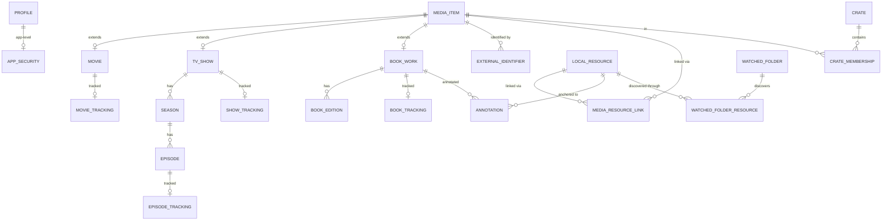

# Database Schema

Colkt uses SQLite as its local source of truth. The database is stored in the platform-specific Tauri application data directory.

Migrations are versioned under `src-tauri/migrations/` and applied by the Rust backend on startup.

The frontend must never access SQLite directly.

## Conventions

- All timestamps are ISO-8601 UTC strings.
- Primary keys are TEXT UUIDs unless otherwise stated.
- Foreign keys are enforced using `PRAGMA foreign_keys = ON`.
- Enum-like columns use TEXT with documented allowed values and database CHECK constraints.
- JSON is used only for data that must remain flexible, such as annotation selectors, metadata cache payloads, crate media-type lists, and settings values.
- Queryable and filterable data must use dedicated columns.
- Boolean values use SQLite INTEGER values constrained to `0` or `1`.
- Durations are stored in seconds.
- Original user media files are never stored inside the database or modified by the application.
- All database writes are performed by the Rust backend.

## Entities

### Schema metadata

```sql
CREATE TABLE schema_migrations (
    version TEXT PRIMARY KEY,
    applied_at TEXT NOT NULL
);
```

Records successfully applied migrations.

### Profile and security

Colkt supports exactly one local profile in V1.

```sql
CREATE TABLE profile (
    id TEXT PRIMARY KEY CHECK (id = 'default'),
    name TEXT NOT NULL,
    picture_uri TEXT,
    created_at TEXT NOT NULL,
    updated_at TEXT NOT NULL
);
```

The profile is created automatically on first launch. Its name and picture can be edited.

The fixed ID prevents multiple profiles from being created in V1.

App-level security is stored separately:

```sql
CREATE TABLE app_security (
    id INTEGER PRIMARY KEY CHECK (id = 1),
    passcode_hash TEXT,
    failed_attempts INTEGER NOT NULL DEFAULT 0
        CHECK (failed_attempts >= 0),
    locked_until TEXT,
    updated_at TEXT NOT NULL
);
```

- The row is a singleton representing application-level security.
- Passcode is optional.
- If `passcode_hash` is NULL, the app has no passcode.
- The passcode is stored as a salted password hash using a modern KDF, preferably Argon2id.
- The encoded hash must contain the parameters and salt required for verification.
- The plaintext passcode is never stored.
- Passcode protection gates access to the application but does not encrypt the database.

### Media items (unified library)

One row represents one library entry, regardless of whether a local file exists.

```sql
CREATE TABLE media_item (
    id TEXT PRIMARY KEY,
    media_type TEXT NOT NULL
        CHECK (media_type IN ('movie', 'tv_show', 'book')),
    title TEXT NOT NULL,
    sort_title TEXT,
    description TEXT,
    release_year INTEGER,
    poster_uri TEXT,
    added_at TEXT NOT NULL,
    updated_at TEXT NOT NULL
);
```

Type-specific data lives in extension tables.

A media item can exist without local resources. Discovering a local file does not automatically create a library entry.

The backend must ensure that each media item has the correct type-specific extension row.

### Movies

```sql
CREATE TABLE movie (
    media_item_id TEXT PRIMARY KEY
        REFERENCES media_item(id) ON DELETE CASCADE,
    runtime_seconds INTEGER
        CHECK (runtime_seconds IS NULL OR runtime_seconds >= 0)
);
```

### TV shows

```sql
CREATE TABLE tv_show (
    media_item_id TEXT PRIMARY KEY
        REFERENCES media_item(id) ON DELETE CASCADE
);
```

Seasons belong to a TV show:

```sql
CREATE TABLE season (
    id TEXT PRIMARY KEY,
    tv_show_id TEXT NOT NULL
        REFERENCES tv_show(media_item_id) ON DELETE CASCADE,
    season_number INTEGER NOT NULL CHECK (season_number >= 0),
    title TEXT,
    description TEXT,
    UNIQUE (tv_show_id, season_number)
);
```

Episodes belong to a season:

```sql
CREATE TABLE episode (
    id TEXT PRIMARY KEY,
    season_id TEXT NOT NULL
        REFERENCES season(id) ON DELETE CASCADE,
    episode_number INTEGER NOT NULL CHECK (episode_number > 0),
    title TEXT,
    description TEXT,
    runtime_seconds INTEGER
        CHECK (runtime_seconds IS NULL OR runtime_seconds >= 0),
    UNIQUE (season_id, episode_number)
);
```

Season number `0` may be used for specials. Episode numbers must be positive.

### Books

A book work represents the abstract book and is the library entry. A book edition represents a particular publication with its own ISBN, publisher, page count, and format.

Tracking and ratings belong to the work. Edition-specific metadata belongs to the edition.

```sql
CREATE TABLE book_work (
    media_item_id TEXT PRIMARY KEY
        REFERENCES media_item(id) ON DELETE CASCADE,
    original_title TEXT,
    first_published_year INTEGER
);
```

```sql
CREATE TABLE book_edition (
    id TEXT PRIMARY KEY,
    book_work_id TEXT NOT NULL
        REFERENCES book_work(media_item_id) ON DELETE CASCADE,
    title TEXT,
    isbn_13 TEXT,
    isbn_10 TEXT,
    publisher TEXT,
    publication_year INTEGER,
    language TEXT,
    page_count INTEGER
        CHECK (page_count IS NULL OR page_count > 0),
    format TEXT
        CHECK (format IN ('physical', 'ebook', 'pdf', 'other'))
);
```

V1 does not attempt to reconcile page numbers between editions. Reading progress belongs to the work, and the preferred edition is stored separately.

### External identifiers

```sql
CREATE TABLE external_identifier (
    id TEXT PRIMARY KEY,
    media_item_id TEXT NOT NULL
        REFERENCES media_item(id) ON DELETE CASCADE,
    provider TEXT NOT NULL,
    external_id TEXT NOT NULL,
    UNIQUE (provider, external_id)
);
```

Examples include:

- `tmdb`
- `tvmaze`
- `openlibrary`
- `isbn`

Multiple external identifiers may belong to one media item.

An external identifier must not cause an automatic merge of library entries. Matching and linking remain subject to user confirmation.

### Local resources (files)

A local resource represents a reference to a user-owned file.

```sql
CREATE TABLE local_resource (
    id TEXT PRIMARY KEY,
    platform_kind TEXT NOT NULL
        CHECK (platform_kind IN ('file_path', 'content_uri')),
    identifier TEXT NOT NULL,
    display_name TEXT,
    size_bytes INTEGER
        CHECK (size_bytes IS NULL OR size_bytes >= 0),
    mime_hint TEXT,
    available INTEGER NOT NULL DEFAULT 1
        CHECK (available IN (0, 1)),
    last_seen_at TEXT,
    created_at TEXT NOT NULL,
    UNIQUE (platform_kind, identifier)
);
```

`identifier` represents:

- An absolute file path on Linux.
- A SAF document URI on Android.

The application stores references to files, not copies of the files.

If a file becomes inaccessible or disappears, its resource row is retained and `available` is set to `0`.

Removing a resource reference must never delete the original file.

### Media-resource links

Connects library entries to their associated local resources.

```sql
CREATE TABLE media_resource_link (
    id TEXT PRIMARY KEY,
    media_item_id TEXT NOT NULL
        REFERENCES media_item(id) ON DELETE CASCADE,
    local_resource_id TEXT NOT NULL
        REFERENCES local_resource(id) ON DELETE CASCADE,
    kind TEXT NOT NULL
        CHECK (kind IN ('primary', 'additional', 'subtitle')),
    subtitle_language TEXT,
    confirmed_at TEXT NOT NULL,
    UNIQUE (media_item_id, local_resource_id, kind)
);
```

Rules:

- A media item can have multiple associated resources.
- A resource can be linked to a media item only after user confirmation.
- `primary` identifies the main resource.
- `additional` identifies another associated resource.
- `subtitle` identifies an external subtitle resource.
- Removing a link does not delete the resource or media item.
- Deleting a media item does not delete its original files or local resource records.

### Crates

Crates are user-defined collections.

```sql
CREATE TABLE crate (
    id TEXT PRIMARY KEY,
    name TEXT NOT NULL,
    description TEXT,
    allowed_media_types TEXT NOT NULL,
    created_at TEXT NOT NULL,
    updated_at TEXT NOT NULL
);
```

`allowed_media_types` is a JSON array containing a subset of:

```json
["movie", "tv_show", "book"]
```

The backend must validate this array when creating or updating a crate.

Membership is stored separately:

```sql
CREATE TABLE crate_membership (
    crate_id TEXT NOT NULL
        REFERENCES crate(id) ON DELETE CASCADE,
    media_item_id TEXT NOT NULL
        REFERENCES media_item(id) ON DELETE CASCADE,
    added_at TEXT NOT NULL,
    position INTEGER,
    PRIMARY KEY (crate_id, media_item_id)
);
```

Rules:

- An item cannot be added to a crate that does not allow its media type.
- Membership is independent of file availability and tracking state.
- Removing an item from a crate does not delete the library entry.
- Deleting a crate does not delete its library entries.
- `position` supports optional manual ordering.

### Tracking and ratings

Tracking is stored separately from media metadata.

Tracking rows are created with their corresponding media entries using the appropriate default status.

#### Movies

```sql
CREATE TABLE movie_tracking (
    media_item_id TEXT PRIMARY KEY
        REFERENCES movie(media_item_id) ON DELETE CASCADE,
    status TEXT NOT NULL DEFAULT 'want_to_watch'
        CHECK (status IN ('want_to_watch', 'watching', 'completed')),
    playback_seconds REAL NOT NULL DEFAULT 0
        CHECK (playback_seconds >= 0),
    duration_seconds REAL
        CHECK (duration_seconds IS NULL OR duration_seconds >= 0),
    rating_10 INTEGER
        CHECK (rating_10 IS NULL OR rating_10 BETWEEN 1 AND 10),
    updated_at TEXT NOT NULL
);
```

Movie tracking includes:

- Want to Watch, Watching, and Completed status.
- Playback position.
- Media duration when available.
- Optional rating from 1 to 10.

#### TV shows

```sql
CREATE TABLE show_tracking (
    media_item_id TEXT PRIMARY KEY
        REFERENCES tv_show(media_item_id) ON DELETE CASCADE,
    status TEXT NOT NULL DEFAULT 'want_to_watch'
        CHECK (status IN ('want_to_watch', 'watching', 'completed')),
    rating_10 INTEGER
        CHECK (rating_10 IS NULL OR rating_10 BETWEEN 1 AND 10),
    updated_at TEXT NOT NULL
);
```

Episode tracking:

```sql
CREATE TABLE episode_tracking (
    episode_id TEXT PRIMARY KEY
        REFERENCES episode(id) ON DELETE CASCADE,
    watched INTEGER NOT NULL DEFAULT 0
        CHECK (watched IN (0, 1)),
    watched_at TEXT,
    playback_seconds REAL NOT NULL DEFAULT 0
        CHECK (playback_seconds >= 0),
    duration_seconds REAL
        CHECK (duration_seconds IS NULL OR duration_seconds >= 0),
    updated_at TEXT NOT NULL
);
```

Rules:

- Marking an episode watched sets `watched = 1` and records `watched_at`.
- Marking it unwatched sets `watched = 0` and clears `watched_at`.
- Re-watching an episode updates its playback position without clearing its watched history.
- Overall show progress and the next unwatched episode are derived by query, not stored separately.

#### Books

```sql
CREATE TABLE book_tracking (
    media_item_id TEXT PRIMARY KEY
        REFERENCES book_work(media_item_id) ON DELETE CASCADE,
    status TEXT NOT NULL DEFAULT 'want_to_read'
        CHECK (status IN ('want_to_read', 'reading', 'completed')),
    current_page INTEGER
        CHECK (current_page IS NULL OR current_page >= 0),
    progress_percent REAL
        CHECK (progress_percent IS NULL OR progress_percent BETWEEN 0 AND 100),
    rating_stars INTEGER
        CHECK (rating_stars IS NULL OR rating_stars BETWEEN 1 AND 5),
    format_kind TEXT
        CHECK (format_kind IN ('physical', 'digital')),
    preferred_edition_id TEXT
        REFERENCES book_edition(id) ON DELETE SET NULL,
    updated_at TEXT NOT NULL
);
```

Book tracking includes:

- Want to Read, Reading, and Completed status.
- Current page when applicable.
- Reading progress percentage.
- Optional physical/digital classification.
- Optional preferred edition.
- Optional rating from 1 to 5.

Progress may be entered as a page number or percentage. Both values can be stored when known.

Physical book progress is distinct from digital reading position. The application must not assume that physical page progress can be obtained from an ebook or PDF reader.

### Annotations

Annotations belong to a book work and may be associated with a particular edition and local resource.

```sql
CREATE TABLE annotation (
    id TEXT PRIMARY KEY,
    media_item_id TEXT NOT NULL
        REFERENCES book_work(media_item_id) ON DELETE CASCADE,
    book_edition_id TEXT
        REFERENCES book_edition(id) ON DELETE SET NULL,
    resource_id TEXT
        REFERENCES local_resource(id) ON DELETE SET NULL,
    kind TEXT NOT NULL
        CHECK (kind IN ('highlight', 'note')),
    format TEXT NOT NULL
        CHECK (format IN ('epub', 'pdf')),
    selector_json TEXT NOT NULL,
    quoted_text TEXT,
    note TEXT,
    color TEXT,
    created_at TEXT NOT NULL,
    updated_at TEXT NOT NULL
);
```

`selector_json` stores the format-specific anchor.

EPUB example:

```json
{
  "type": "epub-cfi",
  "cfi": "...",
  "chapter": "...",
  "textQuote": "..."
}
```

PDF example:

```json
{
  "type": "pdf",
  "page": 12,
  "rects": [
    {"x": 0, "y": 0, "w": 0, "h": 0}
  ],
  "textQuote": "..."
}
```

Rules:

- An annotation is stored in SQLite, never written into the original book file.
- A highlight can contain an attached note in its `note` field.
- Annotation selectors must be validated by the backend before persistence.
- The frontend must not construct or modify annotation anchors without validation.
- `quoted_text` is retained to help detect stale anchors when a resource changes.
- If an anchor cannot be resolved, the annotation is marked as needing review rather than silently repositioned.
- Deleting a local resource sets `resource_id` to NULL; the annotation survives.
- Deleting the book work deletes its annotations.

The `kind` field distinguishes highlights from standalone notes. A note attached to a highlight is stored in that highlight's `note` field.

### Watched folders

Watched folders represent user-selected directories or document trees.

```sql
CREATE TABLE watched_folder (
    id TEXT PRIMARY KEY,
    platform_kind TEXT NOT NULL
        CHECK (platform_kind IN ('file_path', 'document_tree')),
    identifier TEXT NOT NULL,
    display_name TEXT,
    recursive INTEGER NOT NULL DEFAULT 1
        CHECK (recursive IN (0, 1)),
    scan_on_startup INTEGER NOT NULL DEFAULT 1
        CHECK (scan_on_startup IN (0, 1)),
    last_scan_at TEXT,
    created_at TEXT NOT NULL,
    UNIQUE (platform_kind, identifier)
);
```

- Linux folders use filesystem paths.
- Android folders use SAF document-tree URIs.
- Android access depends on persisted URI permissions.
- Folder monitoring is optional on Linux and deferred on Android.
- Manual scanning and optional scan-on-startup are the supported V1 mechanisms.

A watched folder can yield multiple local resources. The relationship must be stored explicitly:

```sql
CREATE TABLE watched_folder_resource (
    watched_folder_id TEXT NOT NULL
        REFERENCES watched_folder(id) ON DELETE CASCADE,
    local_resource_id TEXT NOT NULL
        REFERENCES local_resource(id) ON DELETE CASCADE,
    discovered_at TEXT NOT NULL,
    PRIMARY KEY (watched_folder_id, local_resource_id)
);
```

This relationship records which resources were discovered through which watched folders.

Deleting a watched folder removes its discovery relationships, not the local resources or original files.

A local resource may be discovered through more than one watched folder.

### Metadata cache

```sql
CREATE TABLE metadata_cache (
    id TEXT PRIMARY KEY,
    provider TEXT NOT NULL,
    cache_key TEXT NOT NULL,
    payload_json TEXT NOT NULL,
    fetched_at TEXT NOT NULL,
    expires_at TEXT,
    UNIQUE (provider, cache_key)
);
```

The cache stores responses from optional online metadata providers.

Rules:

- Cached data is disposable.
- Cache entries may be cleared at any time.
- Cache expiration is handled by the backend.
- The app must remain usable when providers are unavailable.
- Cached metadata must not overwrite user-edited fields without user confirmation.

### Settings

```sql
CREATE TABLE app_setting (
    key TEXT PRIMARY KEY,
    value_json TEXT NOT NULL,
    updated_at TEXT NOT NULL
);
```

Stores application preferences such as:

- Theme.
- Scan-on-startup.
- Default player volume.
- Other user-configurable application preferences.

Passcode data is not stored here. It belongs in `app_security`.

### Search

`media_item_fts` is an FTS5 virtual table covering:

- `title`
- `sort_title`
- `description`

It is populated and maintained through triggers on `media_item`.

It provides offline search across the library.

Search does not inspect the contents of media files or books.

## Relationships (ERD)



`app_security` is a singleton application-level record. It is not dependent on the profile row through a database foreign key.

The watched-folder/resource relationship is explicitly represented by `watched_folder_resource`.

## Foreign Keys and Cascades

The following deletion rules apply:

- Deleting a `media_item` cascades to its type extension, tracking, crate membership, external identifiers, annotations, and media-resource links.
- Deleting a `season` cascades to its episodes and episode tracking.
- Deleting a `book_work` cascades to its editions, tracking, and annotations.
- Deleting a `local_resource` cascades to its media-resource links and watched-folder relationships.
- Deleting a `local_resource` sets annotation `resource_id` to NULL. Annotations survive as long as their book work exists.
- Deleting a `crate` cascades to its memberships.
- Deleting a `watched_folder` cascades to its discovery relationships but does not delete local resources.
- Deleting a preferred book edition sets `book_tracking.preferred_edition_id` to NULL.
- Deleting a book edition sets `annotation.book_edition_id` to NULL.

Deleting a library entry must never delete the original media files or unrelated local resource records.

## Indexes

Create indexes for commonly queried fields and foreign-key relationships.

Required indexes:

```sql
CREATE INDEX idx_media_item_media_type
    ON media_item(media_type);

CREATE INDEX idx_media_item_title
    ON media_item(title);

CREATE INDEX idx_season_tv_show
    ON season(tv_show_id, season_number);

CREATE INDEX idx_episode_season
    ON episode(season_id, episode_number);

CREATE INDEX idx_media_resource_link_item
    ON media_resource_link(media_item_id);

CREATE INDEX idx_media_resource_link_resource
    ON media_resource_link(local_resource_id);

CREATE INDEX idx_crate_membership_item
    ON crate_membership(media_item_id);

CREATE INDEX idx_external_identifier_item
    ON external_identifier(media_item_id);

CREATE INDEX idx_episode_tracking_watched
    ON episode_tracking(watched);

CREATE INDEX idx_annotation_item
    ON annotation(media_item_id);

CREATE INDEX idx_annotation_resource
    ON annotation(resource_id);

CREATE INDEX idx_watched_folder_resource_resource
    ON watched_folder_resource(local_resource_id);
```

The following constraints already provide indexes through their UNIQUE or PRIMARY KEY definitions:

- `local_resource(platform_kind, identifier)`
- `watched_folder(platform_kind, identifier)`
- `external_identifier(provider, external_id)`
- `season(tv_show_id, season_number)`
- `episode(season_id, episode_number)`
- `crate_membership(crate_id, media_item_id)`
- `watched_folder_resource(watched_folder_id, local_resource_id)`

Avoid creating duplicate indexes for these constraints.

## Transactions

The following operations must be transactional:

- Creating a media item together with its type extension, default tracking row, and any external identifiers.
- Updating a media item and its type-specific data.
- Creating a link between a resource and a media item.
- Updating resource availability and discovery relationships during a scan.
- Creating or updating a crate and validating its allowed media types.
- Adding an item to a crate after validating its media type.
- Updating tracking and watched history.
- Creating, updating, or deleting annotations.
- Restoring a backup.
- Deleting a media item and applying its cascades.

Folder scanning is asynchronous. Each file's resource registration and discovery relationship must be committed consistently. A failed file operation must not leave partially written rows.

Backup restoration must be atomic: either the complete restore succeeds or the database remains unchanged.

## Migrations

Migrations live in:

`src-tauri/migrations/NNNN_description.sql`

Rules:

- Migrations are applied by the Rust backend on startup.
- Each migration runs inside a transaction.
- The `schema_migrations` table records successfully applied versions.
- Migrations are append-only.
- Never edit an applied migration.
- Schema changes require a new numbered migration.
- Database documentation and the ER diagram must be updated whenever the schema changes.
- Migration tests must verify both successful application and expected schema state.

## Notes and Explicit Limitations

- V1 supports exactly one local profile.
- V1 tracks book progress at the work level. If a user changes editions with different pagination, percentage progress remains valid but the page number may not map exactly.
- Physical book progress is entered by the user; it is not inferred from digital reading position.
- `metadata_cache` is disposable and may be pruned opportunistically.
- Full-text search covers only the fields listed above.
- The application stores references to local media, not copies of original files.
- Android resource availability depends on persisted SAF permissions and the availability of the document provider.
- Folder monitoring is not guaranteed on Android.
- The database is local to the installation. V1 does not include cloud synchronization or an online account system.